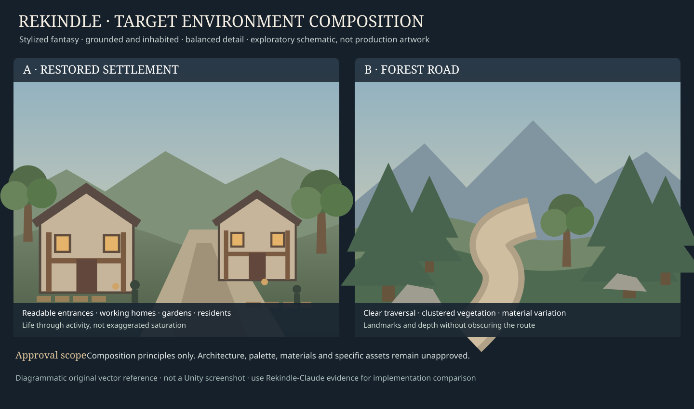

# Stylized settlement and forest-road reference brief

**Status: Exploratory concept-art brief.** No final scene, specific palette, model, or UI layout is approved by this page.

**Illustration status:** Original schematic target reference; approved principles, not approved scene design. See [Target Visual Identity](target-identity.md).

## Creative baseline

- **Style:** stylized fantasy; clear shapes and strong readability.
- **Atmosphere:** balanced and region-specific; welcoming settlement, adventurous forest, genuinely threatening blighted zones.
- **Detail:** balanced; authored vegetation, stone, timber, dirt, props, and natural terrain variation without clutter.
- **Implementation baseline:** Rekindle-Claude `rekindle-vertical-slice`. RPG Kingdom may be consulted as historical reference only.
- **Asset use:** no assumption that RPG Kingdom's Townsmith, Polysplit, or other package selections are already adopted in Rekindle-Claude.

## Reference A: settlement, restored

**Visual target:** player-height, walkable street with recognizable civic/crafting/residential zones, varied rooflines, layered stone-and-timber materials, vegetation integrated into the architecture, and legible building entrances. **Approved atmosphere refinement:** grounded, but visibly alive. Warmth comes from believable inhabited activity—workshops, homes, gardens, residents, trade, and controlled lighting—not indiscriminate saturation. Restoration should communicate the return of daily life and purpose rather than a simple color-grade swap.

**Avoid:** over-detailed surfaces, excessive flowers, uniform facades, repetitive asset placement, or an unplayable postcard composition.

## Reference B: forest road

**Visual target:** winding but navigable path, natural stone and soil transitions, trees in intentional clusters, selective groundcover, foreground-to-background depth, and one or two landmarks visible during traversal.

**Avoid:** arbitrary prop scattering, terrain seams, vegetation blocking the player camera, and paths that lose their intended direction.

## Reference C: same settlement, damaged

**Visual target:** retain recognizable building silhouettes and street layout while communicating structural damage, lost function, blight, reduced warmth, and danger. Darkness should not erase readability.

**Avoid:** swapping the entire settlement for unrelated architecture, using uniform grey tint as the only change, or making the scene unreadable.

## Reference D: restoration sequence

Capture the **same** location from comparable viewpoints before and after recovery, including intermediate states when implemented. Evaluate causality, persistence, continuity, and emotional payoff.

## Review and acceptance

Compare each concept against [Rekindle-Claude evidence](rekindle-claude-baseline.md). Approval should identify *which* qualities to keep (for example, stylized forms or path composition), not blindly adopt the generated architecture, character style, lighting, UI, or exact material colors.

**Still open:** specific texture language, lighting targets, character visual standard, and whether any original RPG Kingdom assets are reused.
