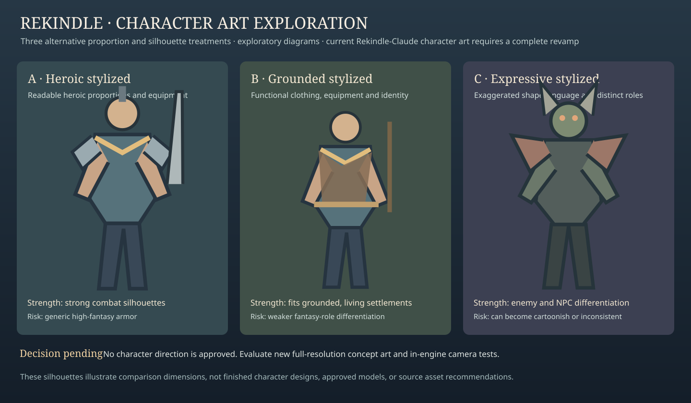

# Target visual identity — reference gallery

**Status: Exploratory reference images.** The stylized-fantasy *style family*, balanced world mood, balanced environment detail, and grounded-but-living restored settlements are approved principles. **The specific images below are not approved production art.**

This page separates **where we want to go** from [where Rekindle-Claude currently is](rekindle-claude-baseline.md). The original RPG Kingdom repo remains optional historical reference, not the default implementation baseline.

## Environment: desired composition

**Target qualities:** readable village routes and entrances, believable inhabited spaces, layered vegetation, distinctive material transitions, landmarks, and terrain that supports player movement. A restored village should communicate returning life and purpose, not simply increased saturation.

**Limitations:** These are deliberately schematic, original vector reference illustrations. They are not actual Unity scenes, screenshots, finalized material palettes, or the full painterly concept boards previously generated in chat. Architecture, geometry, lighting, and exact colors remain subject to review.

## Character visual direction: alternatives, not approvals

**Decision already made:** the current Rekindle-Claude character aesthetic requires a complete redesign.

**Decision still needed:** which new character proportion, shape language, materials, faces, armor, and creature visual family should define production art? The three panels illustrate comparison axes, **not** complete candidate character concepts or approved replacements.

## Compare to current implementation

See the [Rekindle-Claude visual evidence](rekindle-claude-baseline.md) for current settlement, cottage, forge, blighted hollow, and cleansed hollow images. Compare route readability, composition, materials, signs of life, and restoration impact rather than expecting identical assets or camera positions.

## Reference inventory

| Reference | Classification | Source | Approval |
| --- | --- | --- | --- |
| Settlement and forest illustration | Original exploratory diagram | This repository, `docs/assets/visual/target-settlement-forest.svg` | Principles only |
| Character alternatives illustration | Original exploratory diagram | This repository, `docs/assets/visual/target-character-directions.svg` | None |
| Rekindle-Claude evidence JPEGs | Current implementation evidence | `Rekindle-Claude/Docs/Evidence/` on `rekindle-vertical-slice` | Not visual acceptance |
| Earlier generated painterly concept boards | Exploratory concept art in conversation | Not yet archived in this repository | None |

## Next production-art review

1. Produce actual high-fidelity environment concept sheets from the selected stylized direction, ideally with current Rekindle-Claude assets visible for comparison.
2. Produce independent character concepts for player, resident, hostile, and boss roles; compare at gameplay distance.
3. Record human approval of *specific* reference qualities, then create production asset specifications.

**Related:** [Art Direction](art-direction.md), [Settlement and Forest Brief](settlement-forest-reference-brief.md), [Actor Silhouettes](actor-silhouettes.md), [Reference Governance](reference-governance.md).
